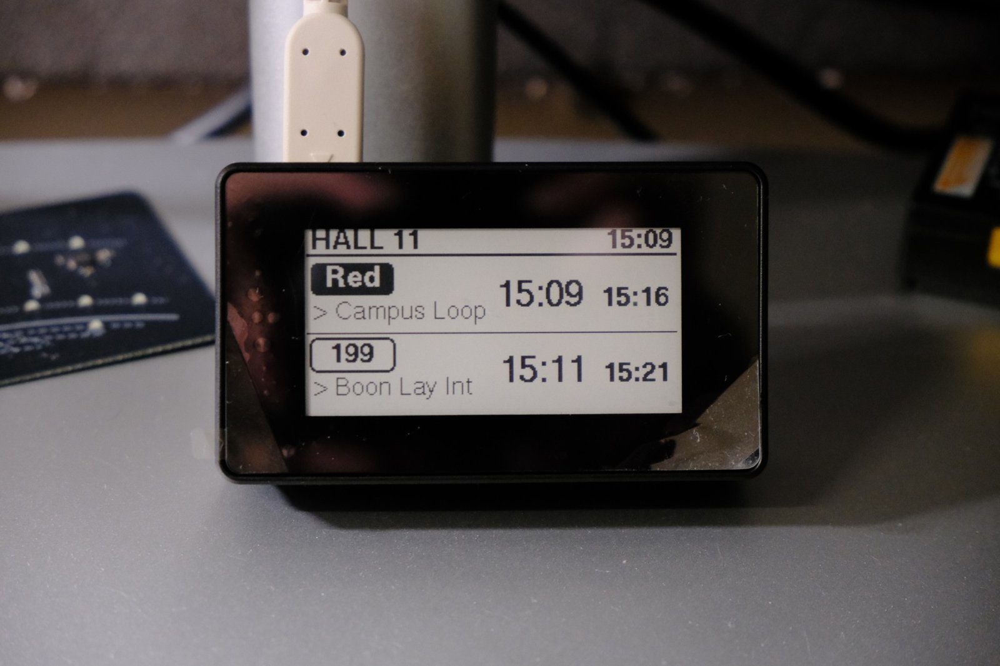
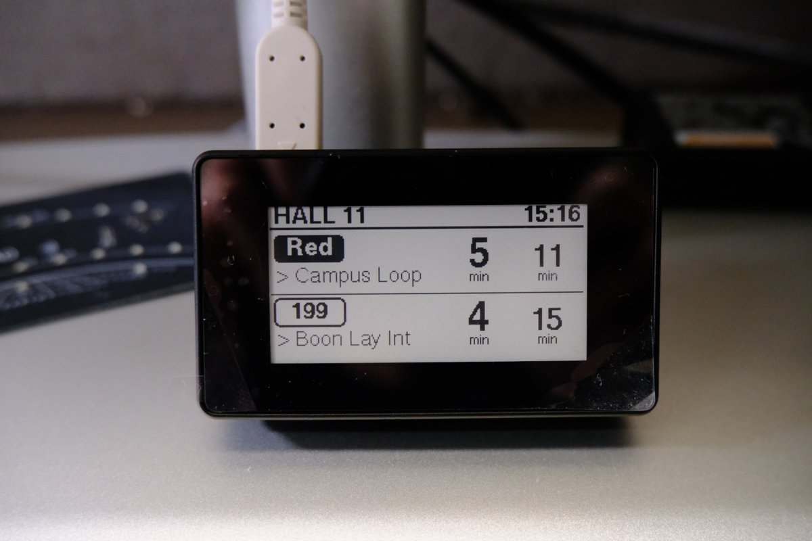
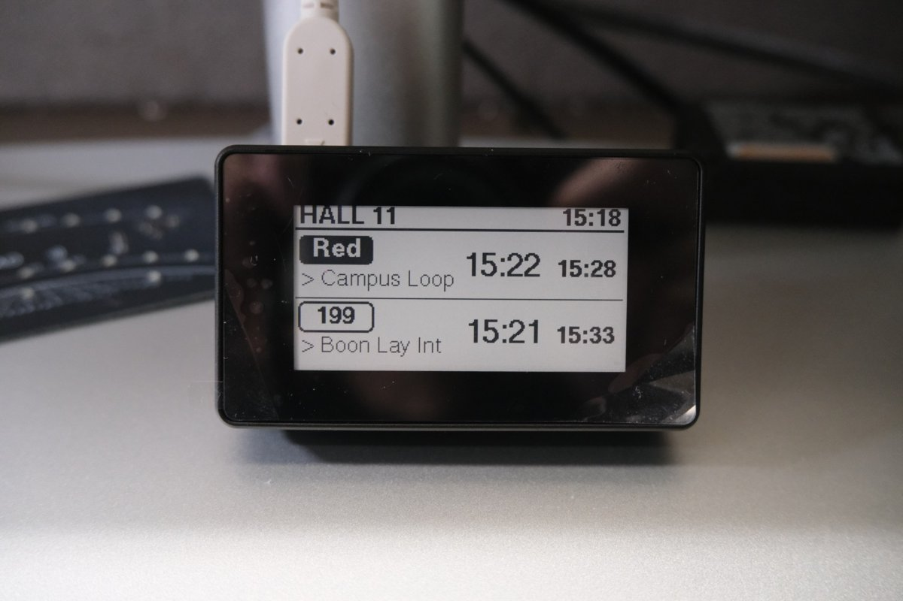
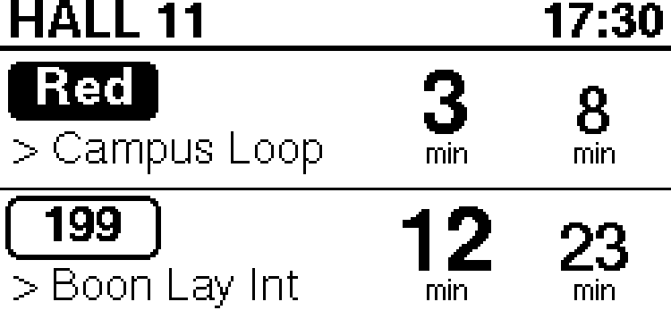
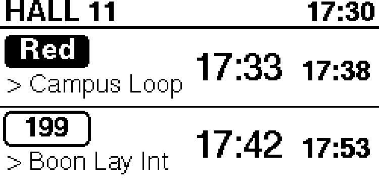
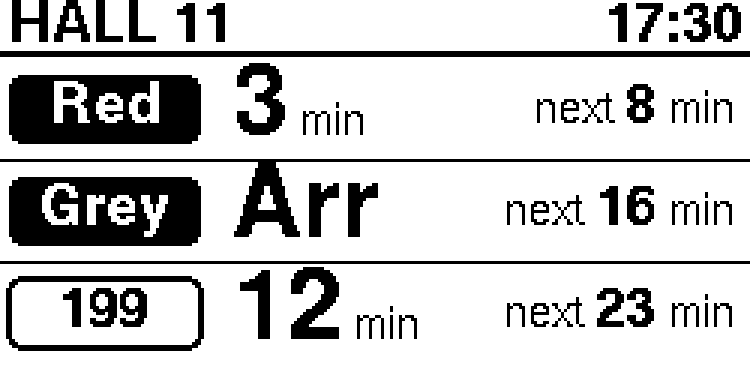

# NTU bus e-ink display



A Raspberry Pi Zero 2 W with a 2.13" touch e-paper screen that shows when the next NTU campus shuttles and
public buses will reach a stop.

It shows NTU's campus shuttles (pulled from the NTU Omnibus app's backend) and public buses (LTA DataMall),
refreshes every 30 seconds, and switches between "minutes away" and arrival clock times when you tap it.
The software is about 1,600 lines of Rust (300 of them tests), compiled to a single 2 MB static binary with no runtime dependencies on the Pi.

## Features

- **NTU campus shuttles**: live ETAs for any campus loop, from the same backend the NTU Omnibus app uses
- **Public buses**: live arrivals for any Singapore bus and stop, from LTA DataMall's BusArrival API
- **Tap to switch**: "3 min / 8 min" or "13:32 / 13:37"
- **Hides routes with no buses**: a row marked `hide_when_empty` drops off while its route has no buses, such as NTU's exam-period Grey loop, but stays and shows "no data" if the board can't get its times
- **Low power**: e-paper keeps its image without power, and partial refreshes don't flash
- **Single static binary**: written in Rust and cross-compiled on your computer with `./build-pi.sh`, so the Pi needs no extra libraries

## Hardware

| Part | Notes |
| --- | --- |
| Raspberry Pi Zero 2 W with a 40-pin header | The Zero 2 WH comes with the header soldered on; a plain Zero 2 W ships without one. The case that comes with the HAT fits a Pi Zero. Other Pis with a 40-pin header can drive the HAT, just not inside that case. |
| [Waveshare 2.13" Touch e-Paper HAT](https://www.waveshare.com/2.13inch-touch-e-paper-hat.htm) with case | 250×122, black and white, SSD1680 e-paper controller and GT1151 capacitive touch |
| microSD card | Raspberry Pi OS Lite (64-bit) |
| Raspberry Pi micro USB power supply | |

The HAT plugs straight onto the Pi's header, so there's no wiring.

## How it works

```
             every 30 s
┌───────────────┐    HTTPS     ┌──────────────────────────┐
│               │ ───────────▶ │ NTU Omnibus (OutSystems) │  shuttles
│   Rust app    │              └──────────────────────────┘
│  (on the Pi)  │    HTTPS     ┌──────────────────────────┐
│               │ ───────────▶ │ LTA DataMall BusArrival  │  public buses
└──────┬────────┘              └──────────────────────────┘
       │ render 250×122 1-bit framebuffer (embedded-graphics + u8g2 fonts)
       │ rotate into the panel's native 122×250 layout
       ▼
   SPI ──▶ SSD1680 e-paper        I2C ◀── GT1151 touch (tap = toggle mode)
```

| File | What it does |
| --- | --- |
| [`src/sources.rs`](src/sources.rs) | NTU Omnibus and LTA DataMall clients; both return arrival times, soonest first |
| [`src/render.rs`](src/render.rs) | Draws the board into a framebuffer; also writes PNGs so layouts can be checked on a laptop |
| [`src/hw.rs`](src/hw.rs) | E-paper and touch drivers, ported from Waveshare's Python driver to [`rppal`](https://github.com/golemparts/rppal) |
| [`src/main.rs`](src/main.rs) | Config, the keep-or-drop rule for stale times, and the loop that redraws on each fetch and each tap |
| [`config.toml`](config.toml) | Which stops and routes to show |

### Getting shuttle data out of the NTU app

NTU doesn't publish an API for its campus shuttles, but the NTU Omnibus app has to get its ETAs from
somewhere. I pulled the APK, unpacked it, and found it's an [OutSystems](https://www.outsystems.com/) app:
the UI logic ships as JavaScript, and every data call is a JSON `POST` to a `screenservices` endpoint.
The notes from that are in [ENDPOINTS.md](ENDPOINTS.md).

What the requests need:

- **No login.** Arrival data only needs an anonymous CSRF header and cookie, which are the same for every install.
- **Every request carries two version hashes.** `moduleVersion` changes on every NTU redeploy and
  `apiVersion` identifies each action. When NTU redeploys and either goes stale, the board fetches the new
  `moduleVersion` from `/moduleservices/moduleversioninfo`, and reads the action's new `apiVersion` from the
  app's live JavaScript (the web app serves the same scripts as the APK).
- **`viewName` matters.** Each request has to name the app screen that hosts the action, otherwise the
  server answers "No role validation found".
- **Two ETA flavours.** `ActionGetETAAndNextETA_FMS` returns shuttle ETAs in minutes (`"-"` for none);
  `_LTA` is NTU's relay of LTA data for the 179/179A/199 and returns seconds.

When a row stops working, `ntu-bus --probe` (on the Pi: `ntu-bus --config /etc/ntu-bus/config.toml --probe`)
prints each action's `apiVersion`, built in and in NTU's live scripts, and the raw response behind every row.

Public buses normally come from LTA DataMall directly, which covers every bus in Singapore. Without a DataMall
key, the board falls back to NTU's relay, which only has the 179, 179A and 199.

### The screen

Each route gets a row. On the left is the route badge (filled for campus shuttles, outlined for public
buses) with the destination under it. On the right is the next bus in large type, with the unit under the
number, and the bus after it in smaller type. A bus less than a minute away shows "Arr"; other times are
rounded down to whole minutes. Times are aligned by their actual drawn pixels rather than font metrics,
so numbers, "Arr" and clock times all sit on the same line.

Tapping the screen switches between minutes away and arrival clock times, redrawing straight away from the
times the board already has. The header shows the `title` from the config and the time of the last redraw.

If fetching a row's times fails once, the board keeps showing the last times it got; if the next fetch fails
too, that row shows "no data". While LTA DataMall is failing, the 179, 179A and 199 come from NTU's relay instead.

With more than two rows on screen, the board switches to a compact layout: badge, next bus and "next N min"
on one line, without the destination. Rows marked `hide_when_empty` drop off while they have no buses, so the
board only goes compact when it needs to. In the three-row render below, the middle row is NTU's exam-period Grey loop.

| Minutes | Clock times |
| --- | --- |
|  |  |

| Minutes | Clock times | Three rows |
| --- | --- | --- |
|  |  |  |

### Driving the e-paper from Rust

Waveshare only ships C and Python drivers. The panel protocol is small, though: reset, a dozen register
writes, send 4,000 bytes of image to RAM, trigger an update, and wait for the BUSY pin to drop.
[`src/hw.rs`](src/hw.rs) is a ~200-line port of their `epd2in13_V4.py` and `gt1151.py`.

- **Full vs partial refresh.** Full refreshes flash black and white to clear ghosting; partial refreshes update
  silently. By default the board does a full refresh after every 20 partial ones; `full_refresh_every`
  in the config changes this. A redraw that would show the same image as before is skipped, so the panel only
  refreshes when a number or the clock has changed.
- **Rotation.** The panel is natively 122×250 portrait, MSB-first, 1 = white. Everything is drawn landscape and
  rotated 90° when packing bytes, with a `flip` option for mounting it the other way up.
- **Fetching** runs on its own thread, so a slow or dead network never delays a tap.
- **Touch** runs on its own thread. It checks the GT1151's interrupt pin every 20 ms, reads the touch over I2C
  when the pin goes low, and counts only the start of a touch as a tap, so holding a finger on the screen is still one toggle.

## Build it yourself

### Preview on your computer

```bash
cargo run -- --preview preview.png --once
```

Drop `--once` to keep redrawing every 30 s.

### Tests

```bash
cargo test
```

The tests run without a Pi. One of them compares every layout, pixel for pixel, with the sample boards in
[`docs/images`](docs/images). After changing a layout on purpose, redraw them with
`UPDATE_SAMPLES=1 cargo test sample_boards` and check the PNGs.

### Build for the Pi

Static binaries, no libraries needed on the Pi. Needs `zig`, `cargo-zigbuild` and the two Pi targets:

```bash
brew install zig
```

```bash
cargo install --locked cargo-zigbuild
```

```bash
rustup target add aarch64-unknown-linux-musl armv7-unknown-linux-musleabihf
```

Then build:

```bash
./build-pi.sh
```

This writes `dist/ntu-bus-aarch64` (64-bit Raspberry Pi OS) and `dist/ntu-bus-armv7` (32-bit).

### Set up the Pi

1. Flash **Raspberry Pi OS Lite** with Raspberry Pi Imager. In its settings, set a username, Wi-Fi and enable SSH.
2. With the Pi unplugged, fit the HAT on the GPIO header, pressing it all the way down, and close the case.
3. Copy the files over and run the installer. Replace `USER@HOSTNAME` with the username and hostname you set in Raspberry Pi Imager:

   ```bash
   scp dist/ntu-bus-* config.toml deploy/ntu-bus.service deploy/install.sh USER@HOSTNAME.local:
   ```

   ```bash
   ssh USER@HOSTNAME.local sudo sh install.sh
   ```

   It turns on SPI (screen) and I2C (touch), installs the binary that matches the Pi, installs the config
   (only if there isn't one already) and the systemd service, then reboots.

4. Watch the logs: `journalctl -u ntu-bus -f`

If the image is upside down in the case, set `flip = true` in `/etc/ntu-bus/config.toml` and
`sudo systemctl restart ntu-bus`.

### Choose your stops

Edit [`config.toml`](config.toml) (on the Pi: `/etc/ntu-bus/config.toml`, then restart the service). A misspelt
or unknown key stops the board with an error naming it, shown by `journalctl -u ntu-bus`:

```toml
[[rows]]
kind = "shuttle"          # NTU campus shuttle
label = "Red"
dest = "Campus Loop"      # shown under the badge when there are two rows or fewer
stop = "Hall 11 Blk 55"   # NTU stop name
route = "Red"

[[rows]]
kind = "public"           # any Singapore public bus
label = "199"
dest = "Boon Lay Int"
stop = "27199"            # 5-digit LTA stop code
service = "199"
```

Add `hide_when_empty = true` to a row that doesn't run all the time, such as Green (weekdays only), Brown (weekends
and public holidays only) or the exam-period Grey loop.

To find the `stop` value, list a route's stops in order:

```bash
cargo run -- --stops Red
```

```
Hall 11 Blk 55
Nanyang Crescent Halls
Hall 12
...
```

This works for the campus shuttles (Red, Blue, Green, Brown, Grey) and for the 179, 179A and 199, which print
the LTA stop code next to the name:

```
22009  Boon Lay Int
22489  Blk 683A
...
27199  Hall 11
```

For any other public bus, the 5-digit code is printed on the stop's sign and shown in most bus apps.
On the Pi the same option is `ntu-bus --stops Red`.

### LTA DataMall key (recommended)

Register at [LTA DataMall](https://datamall.lta.gov.sg/content/datamall/en/request-for-api.html) for an
AccountKey, then on the Pi:

```bash
echo 'LTA_ACCOUNT_KEY=your-key-here' | sudo tee /etc/ntu-bus/env && sudo chmod 600 /etc/ntu-bus/env && sudo systemctl restart ntu-bus
```

Without a key, public buses come from NTU Omnibus, which only covers 179, 179A and 199. NTU's relay doesn't include the 179B.

## Credits

- Inspired by the Raspberry Pi Foundation's [train timetable tutorial](https://www.raspberrypi.com/tutorials/train-timetable-raspberry-pi-tutorial/)
  and [bdamokos/rpi_waiting_time_display](https://github.com/bdamokos/rpi_waiting_time_display), a fuller-featured
  e-paper transit board, also on a 2.13" panel
- Layout ideas from the MTA's countdown clock redesign and LTA's bus stop displays
- E-paper and touch init sequences from Waveshare's [Touch_e-Paper_HAT](https://github.com/waveshareteam/Touch_e-Paper_HAT) drivers
- Public bus data from [LTA DataMall](https://datamall.lta.gov.sg/); shuttle data from NTU Omnibus.
  This project isn't affiliated with NTU or LTA, and the NTU endpoints are unofficial and may change at any time
- Built with [embedded-graphics](https://github.com/embedded-graphics/embedded-graphics), [u8g2-fonts](https://github.com/Finomnis/u8g2-fonts), [rppal](https://github.com/golemparts/rppal) and [ureq](https://github.com/algesten/ureq)
